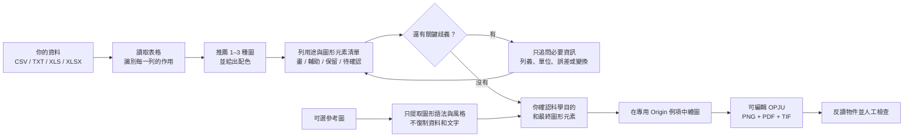
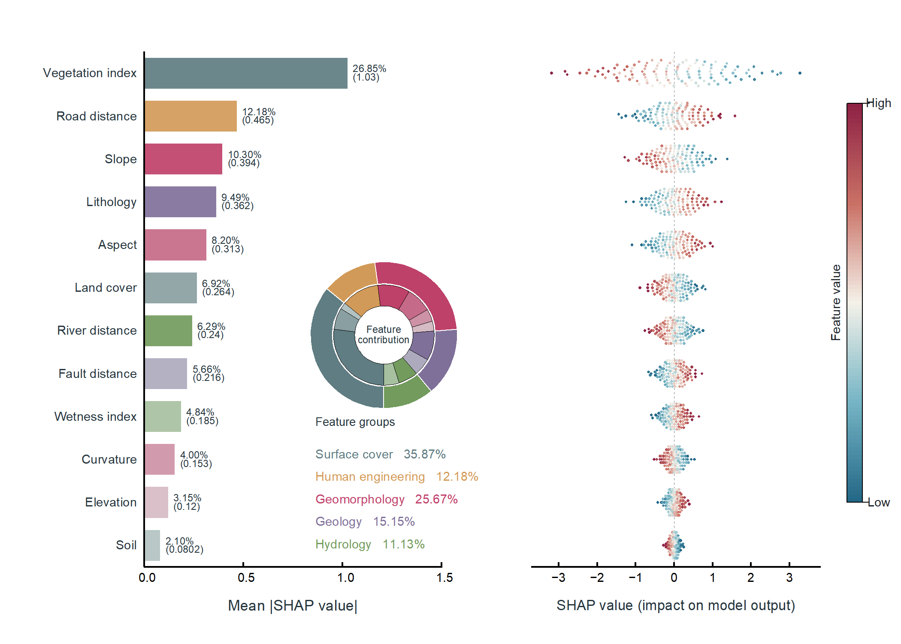
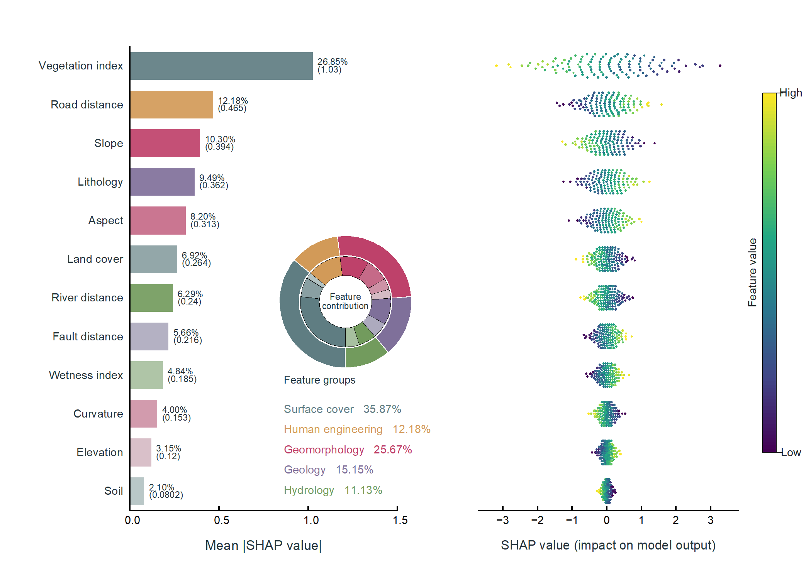
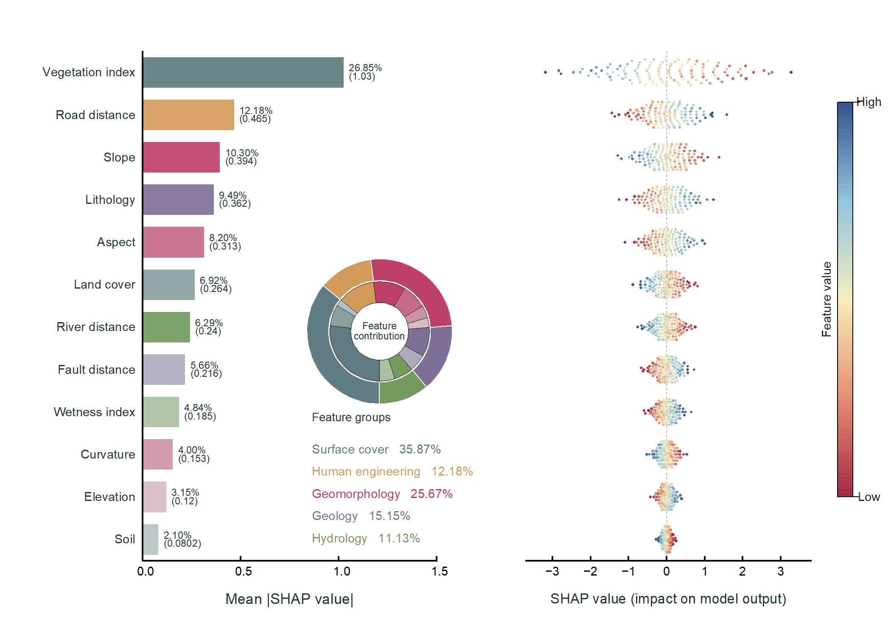
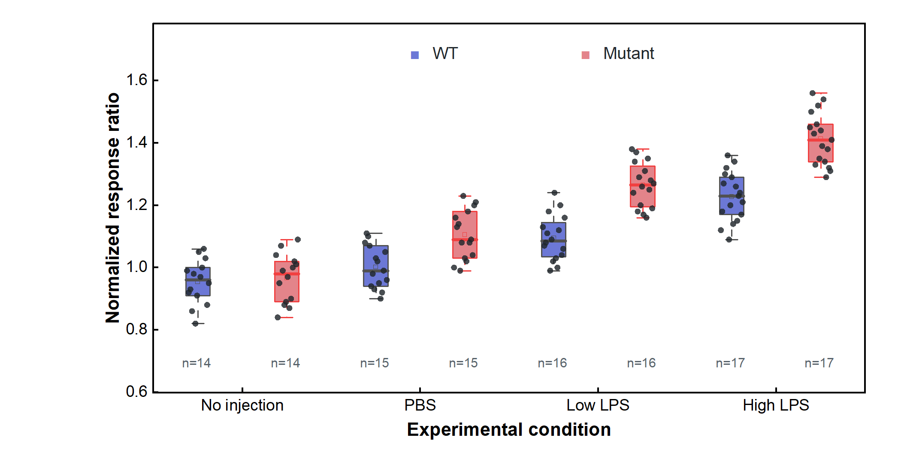
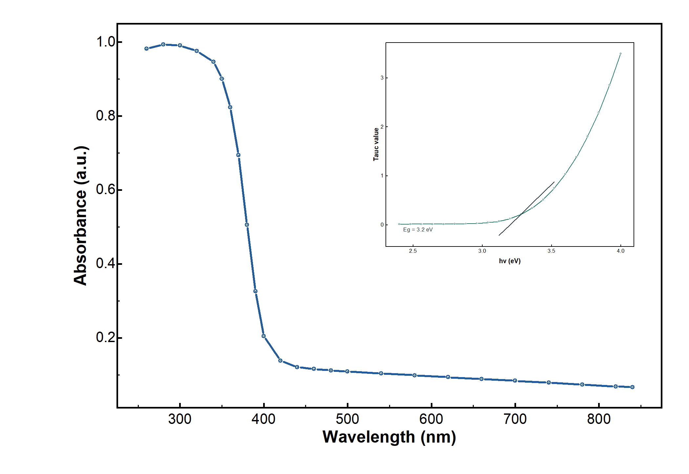
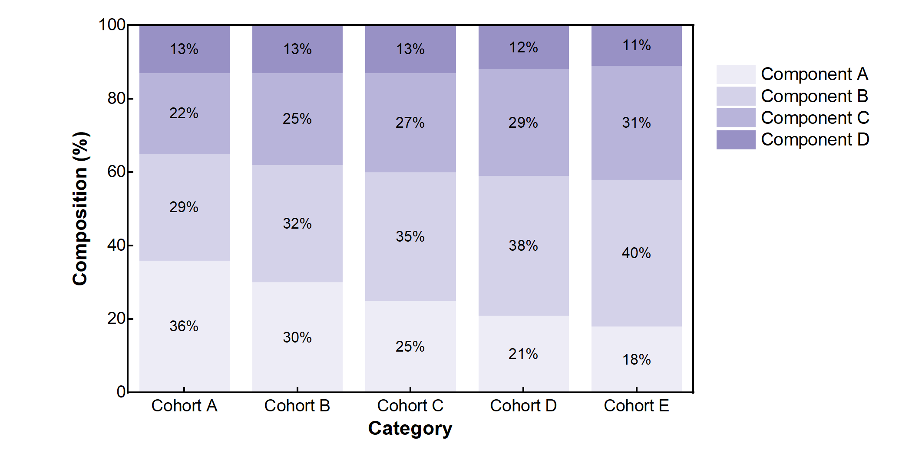
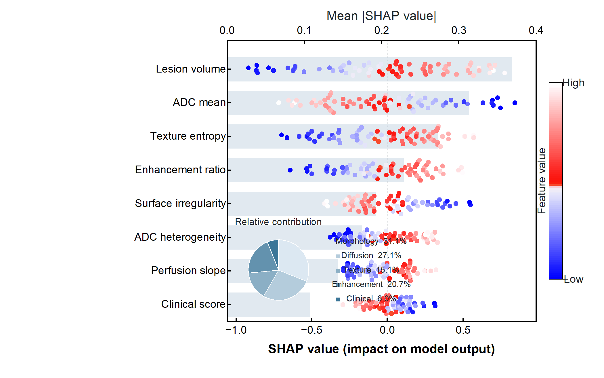
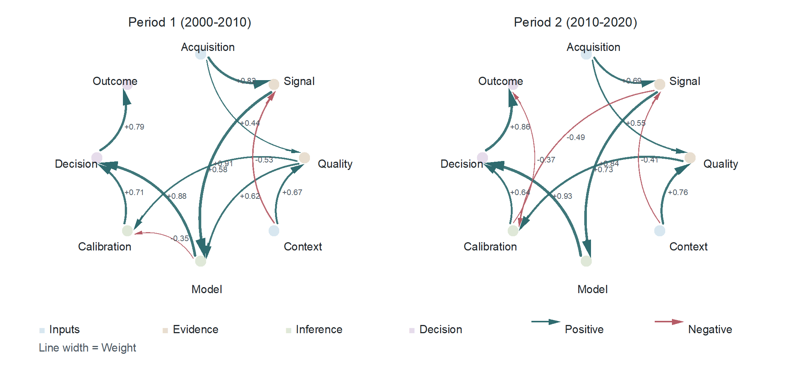
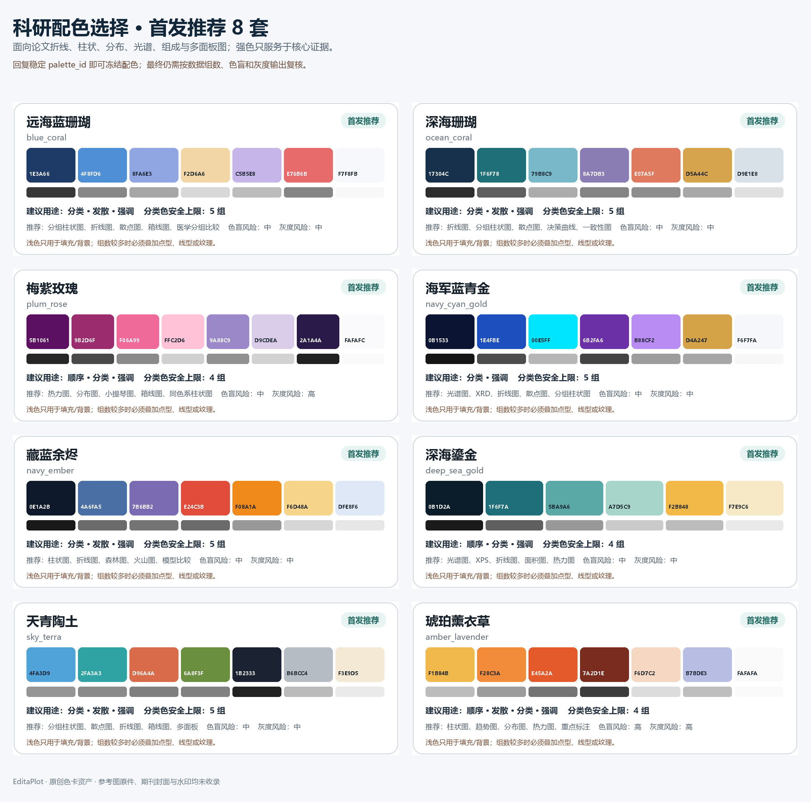

<div align="center">
  
  <h1>EditaPlot · 艾迪圖</h1>
  <p><strong>AI 驅動的可編輯科研繪圖工作流</strong><br>AI-guided editable scientific figures</p>
  <p>
    
    
    
    
    
    
    <a href="https://github.com/liushunqi8-hash/editaplot2026"></a>
  </p>
  <p><a href="README.en.md">English</a> · <a href="README.zh-TW.md">繁體中文</a> · <strong>簡體中文</strong>（雙語簡介見下方，完整版本見對應語言檔案）</p>
</div>

EditaPlot 是一个面向 Codex 的 Windows 本地科研绘图 Skill。你把自己的实验数据交给它后，它会依次理解数据、逐列说明用途、推荐图形、请你确认图形元素、调用 Origin 并验证结果，最后生成**可编辑 OPJU**，同时导出 PNG、PDF、TIF。

EditaPlot is a Codex skill for editable scientific plotting on Windows. You hand it your experimental data; it reads the table, proposes chart types, asks you to confirm each column's role and the figure elements, drives a dedicated Origin instance, and finally produces an **editable OPJU** together with PNG, PDF, and TIF exports.

EditaPlot 是一個導向 Codex 的 Windows 本機科學繪圖 Skill。你把實驗資料交給它後，它會依序理解資料、逐欄說明用途、推薦圖形、請你確認圖形元素、呼叫 Origin 並驗證結果，最後產出**可編輯 OPJU**，同時匯出 PNG、PDF、TIF。

我不希望它只是一套"替换数字"的静态模板，也不会让 Python 预览图冒充 Origin 成图。科学含义和最终选择始终由你决定；遇到把握不足的数据，EditaPlot 会把不确定的列单独列出来请你确认，不会擅自补列、拟合或推断结论。

It is not a static "replace-the-numbers" template, and it never passes a Python preview off as the real Origin figure. Scientific meaning and the final choice stay with you; ambiguous columns are surfaced for your confirmation rather than silently filled in, fitted, or reinterpreted.

它不只是一套「替換數字」的靜態範本，也不會讓 Python 預覽圖冒充 Origin 成品圖。科學意義與最終選擇始終由你決定；遇到不確定的資料，EditaPlot 會把有疑慮的欄位單獨列出請你確認，不會擅自補欄、擬合或推論結論。

> [!WARNING]
> **中文：** 目前只完成了 Windows 10/11 x64 實體電腦上的完整驗證。暫未提供 macOS（Intel 與 Apple Silicon）、Linux、WSL、Wine/CrossOver、Parallels 或其他虛擬機器版本。如果你使用 Mac，請換用 Windows 實體電腦完成 Origin 全流程。
>
> **English:** Fully verified only on a physical Windows 10/11 x64 machine. macOS (Intel and Apple Silicon), Linux, WSL, Wine/CrossOver, Parallels, and other virtual machines are not supported yet. If you are on a Mac, please use a physical Windows host for the full Origin pipeline.

> [!IMPORTANT]
> **中文：** 按 [Apache License 2.0](LICENSE) 開源。當前相容目標為 Origin/OriginPro 2021–2026b（v0.1.1 已在 Origin 2026 / 10.30 上實測透過）。你不必提前開啟 Origin，EditaPlot 會在繪圖前自動啟動一個專用例項；它不會替你安裝或修改 Origin。
>
> **English:** Released under [Apache License 2.0](LICENSE). Targets Origin/OriginPro 2021–2026b (v0.1.1 has been verified on Origin 2026 / 10.30). You do not need to open Origin beforehand — EditaPlot launches a dedicated instance itself and never installs or modifies Origin for you.

## 一眼看懂



當我說“已經畫好”時，你會拿到可繼續編輯的 Origin 專案和 PNG、PDF、TIF；我還會檢查原始資料沒有被改動、座標軸和文字完整，並確認全部必需產物透過格式、物件反讀和人工視覺檢查。

## 先理解資料，再決定畫什麼

很多科研表格並不是“每個數字都要畫”。我會先把**每一列**放進下面一種用途，並用大白話請你確認：

| 用途 | 在圖中怎麼處理 |
|---|---|
| 主要證據 | 作為實測點、主曲線、柱體等核心元素繪製 |
| 可見輔助 | 作為背景、擬合線、殘差、參考線或物相刻線繪製 |
| 僅用於計算或驗證 | 保留用於權重、篩選、座標或佈局，不畫成曲線 |
| 保留但不繪製 | 留在資料對映和可編輯專案中，圖上不顯示 |
| 仍不確定 | 暫停規劃，先問清楚用途，不能自動猜成新曲線 |

確認時你會看到“這是什麼資料、哪些列會畫、哪些列不會畫、會出現哪些圖形元素、哪些計算不會自動做”。只要原始檔、列對映或理解結果發生變化，這次確認就會失效，需要重新核對。

### GSAS / GSAS-II XRD Rietveld 示例

我已為普通 XRD、GSAS-II Powder CSV 和 Publication CSV 加入專門的理解規則。以精修表為例，EditaPlot 可以把 Observed 識別為實測點、Calculated 識別為計算線，並按檔案實際提供的內容加入 Background、Difference 和具備明確身份的 Phase 刻線；`weight`、`Q`、`Used`、`diff/sigma`、`Axis-limits` 等列會保留為輔助或控制資料，不會被誤畫成強度曲線。

Publication CSV 中已經帶顯示位置的 `Diff` 會按源值直接繪製，不會再次偏移。我也不會自動計算背景、差值、Rwp、χ²，或替你識別物相和峰歸屬。倉庫內提供了 [`example_gsas_powder.csv`](runtime/templates/xrd/example_gsas_powder.csv) 與 [`example_gsas_publication.csv`](runtime/templates/xrd/example_gsas_publication.csv)，可以先拿它們熟悉格式。

### 用參考圖告訴我“想要這種表達”

你也可以上傳一張 PNG、JPEG 或 TIFF 參考圖。我會先把它理解為“圖形簡報”：提取面板、插圖、點線柱等圖形元素、資料編碼和有限的視覺風格，再把**適合當前模板且有使用者資料支撐**的部分列出來請你單獨確認。

這條路線不會從畫素反推實驗資料，不復制參考圖中的數值、文字、擬合結果、物相、Logo 或水印，也不會把參考圖片塞進 OPJU。它的目標是安全借鑑圖形語法，而不是承諾任意圖片 1:1 復刻；當前模板表達不了的關鍵元素會明確拒絕或保留模板預設值。

參考圖只是建議，你自己的明確選擇優先。你可以直接指定想要的系列顏色、線寬、填充透明度、
畫幅比例，以及圖例是否顯示、是否無框和放置位置。我會在繪圖前逐項告訴你哪些會**採用**、哪些
暫時**保留模板預設**、哪些因當前模板尚未驗證而**拒絕**；不會把“你可以提出偏好”包裝成
“所有模板都已自動支援”。對 XPS，參考圖和外觀偏好都不能改寫原始資料、列用途、結合能軸方向、
峰組分身份或穩定的單區域漸變填充 API。

也就是說，你可以在三種方式中選擇：直接使用模板預設；讓參考圖提供近似風格建議；或給出精確
自定義值。三者衝突時，以你明確確認的精確值為準，但仍須透過當前模板的能力和反讀門禁。

XPS 想精確改樣式時，我建議你直接這樣說：“Raw 用 `#173F5F`、Envelope 用 `#C94C4C`，
線寬 `2.4 pt`、填充透明度 `38%`、畫幅 `18 × 18 cm`，隱藏圖例；科學含義保持不變。”
我會把確認值凍結到 `--visual-style-json`，不合法的精確值會直接請你修正，不會靜默退回預設。

## Star 趨勢

這是我從開源首日開始記錄的 GitHub Star 總數。首個快照是一個真實的 31 Stars 起點；後續每日快照會自然連成折線。

<div align="center">
  <a href="https://github.com/liushunqi8-hash/editaplot2026"></a>
</div>

我只儲存“日期 + 倉庫 Star 總數”，不讀取或儲存使用者名稱、賬號 ID、個人加星時間或名單。

## 能力覆蓋

| 領域 | 已覆蓋圖形與證據 |
|---|---|
| 材料與光譜 | XPS 掃描/擬合、XPS 多譜線對比、普通 XRD、GSAS/GSAS-II XRD Rietveld、XAS、FTIR/IR、NMR、DSC、PL/TRPL、UV–Vis/Tauc、EIS、CV、LSV、三維多條件 Nyquist |
| 通用統計 | 柱狀/條形、誤差棒、堆疊/百分比堆疊、餅圖、桑基、多階段環形有向加權網路、折線、趨勢、散點、氣泡、雷達、熱力圖（支援高密度矩陣自適應佈局） |
| 分佈與效應 | 原始點彙總、箱線、小提琴、Raincloud、直方圖、森林效應圖、三維雙密度曲線與使用者提供的基線焦點 |
| 醫學與深度學習 | ROC、PR、校準、DCA、混淆矩陣、Bland–Altman、配對縱向軌跡、分組箱線、複合預計算 SHAP（蜂群 + Mean \|SHAP\| + 真實色標 + 可選分組貢獻）、醫學多面板規劃 |

我不會擅自平滑資料、刪除異常值、補峰、計算誤差、擬合曲線、識別物相或訓練模型。壽命、帶隙、SHAP 等分析結果也只有在你明確提供後才會畫進圖裡。

SHAP 路線只讀取你在上游已經計算好的逐樣本長表，最少需要 `Feature + SHAP value + Feature value`；
還可提供 `Sample ID`、`Feature Order`、`Mean absolute SHAP`、`Feature Group` 和
`Group contribution (%)`。我會按實際列自動選擇“僅蜂群”“蜂群 + Mean |SHAP|”或
“蜂群 + Mean |SHAP| + 分組貢獻”三種 profile。缺少的彙總量若需要從已提供 SHAP 值派生，
會單獨列出公式、來源與用途並等你確認；源 CSV 不會被重寫。可先檢視
[`medical_shap_summary.csv`](examples/gallery/medical_shap_summary.csv)。

### SHAP 分欄重要性與雙層環圖

我新增了獨立的 `shap_dashboard` 模板：左側是特徵重要性和佔比，右側保留每個樣本的 SHAP
貢獻，雙環用外環表示特徵組、內環表示組內特徵。空白足夠時雙環內嵌在條形圖區，否則自動放入
下方獨立區域，避免遮擋資料。
支援 2–20 個特徵和 2–5 個特徵組，原有 `shap_summary` 疊加式模板繼續可用。

準備四個必需列：`Feature`、`SHAP value`、`Feature value`、`Feature Group`，也相容中文列名。
每個特徵至少 3 個觀測，可從 [1,440 行合成資料樣例](examples/gallery/shap_dashboard.csv) 開始。
我不會訓練模型或計算 SHAP；重要性、佔比和顯示變換會先列明公式並請你確認。

直接說：“請用 `$editaplot` 的 SHAP 分欄與雙層環圖，配色選紫綠金，保留所有資料。”
三種配色對應 `dashboard_blue_red`（藍白酒紅）、`dashboard_viridis`（紫綠金）和
`dashboard_red_blue`（紅黃藍），由 Codex 寫入列對映的 `plot_mode`。

<div align="center">
  
  
  
</div>

### 新增材料與關係資料怎樣準備

| 想畫的圖 | 最少需要的資料 | 我會堅持的邊界 |
|---|---|---|
| XPS 多譜線對比 | 結合能 + 至少兩條獨立實測強度 | 預設直接疊加；背景、包絡、殘差和分峰列不會被誤當成樣品 |
| FTIR / IR | 波數 + 一條或多條吸光度/透過率 | 波數從高到低顯示；不自動校正、平滑、標峰或指認官能團 |
| NMR | 化學位移（ppm）+ 一條或多條強度 | 化學位移從高到低顯示；不自動相位校正、積分、認峰或歸屬 |
| DSC | 溫度 + 一條或多條熱流 | 先確認吸熱/放熱方向；不自動識別 Tg、Tm、Tc 或計算焓變 |
| PL / TRPL | 波長或時間 + 發光強度；擬合列可選 | 支援多樣品/多條件；擬合和壽命必須由你提供 |
| UV–Vis / Tauc | 波長 + 吸光度/透過率；Tauc 資料可選 | 支援多樣品；不自動換算光子能量、選指數、擬合或計算帶隙 |
| 桑基圖 | `Source + Target + Value` 正權重長表 | 表達流量或組成傳遞；不補節點、不推斷缺失流量 |
| 環形有向加權網路 | [`Panel + Source + Target + Weight`](examples/gallery/circular_network.csv)；`Sign` 與最多 4 個節點組可選 | 比較多個面板中的定向關係；共享節點位置和統一線寬尺度，單面板超過 12 條邊時保留但隱藏邊標籤，不把相關關係解釋成因果 |
| 三維雙密度曲線與基線焦點 | [`Condition ID + Condition Position + Density X + Solid Density + Dashed Density + Focal X`](examples/gallery/density_ridgeline3d.csv)；2–6 個真實條件 | 兩條密度和每組一個焦點都必須由你在上游提供；焦點固定在 Z=0，不自動做 KDE、找峰、求交點或閾值 |

高密度熱力圖會保留矩陣中的每一個值和原始順序，只減少螢幕上的重複刻度文字：矩陣較密時隱藏單元格數字、稀疏顯示行列標籤，並把 colorbar 與資料區分開。公開頁面只展示一張真實 Origin 生成的 30×30 案例；它已經完成 OPJU/PNG/PDF/TIF、軸與顏色條物件反讀及人工視覺檢查。原來的小矩陣和 40×40 案例仍保留在驗證資產中，供迴歸與審計使用，不再重複展示。

## 真實 Origin 示例

我用合成教學資料製作並人工檢查了下面這些示例。公開圖片已去除可能洩露資訊的後設資料，每個檔案的校驗值都記錄在清單中。

<div align="center">
  
  
  
  
  
  
</div>

➡️ [瀏覽 48 個對外展示案例與簡要用途](docs/gallery.md)

當前公開能力包含 41 條 Origin 繪圖路線。倉庫保留 50 張透過實機產物、物件反讀、人工視覺檢查和公開圖片審計的驗證 PNG，其中 48 張進入頁面展示；兩個未展示案例只是熱力圖的歷史迴歸證據。DSC、NMR、FTIR/IR、XPS 多譜線對比、PL 多條件、UV–Vis 多樣品、30×30 高密度熱力圖、576 點複合 SHAP、多階段環形有向加權網路圖與三維雙密度基線焦點圖都已完成 Origin 2024b 實機門禁。

### 一次正常執行要多久

如果專案環境已經配好、資料量正常，而且必要確認已經完成或無需繼續補充，我把**本地識別、真實 smoke、啟動 Origin、繪圖、匯出和驗證在 4–5 分鐘內完成**視為合理範圍。它不是對每臺電腦的固定秒數承諾：第一次安裝依賴、大型 Excel、複雜圖層、較慢磁碟或 Windows 安全掃描都可能增加一些時間。

**在沒有等待你確認或批准許可權、並且沒有新的本地進度事件時，30–60 分鐘不屬於正常繪圖耗時。**
新版會在可安全恢復的瞬時啟動故障後嘗試清理自有例項；只有清理成功才自動重試一次，同時保留實時進度。它不會為了
製造一個“超時結束”而強殺可能正在管理隱藏 Origin 的 Python 程序；遇到長時間無進度時，我會讓
Codex 先報告“當前停在哪一階段”和該階段已經耗時多久，保留現有診斷，再做最小排查：

1. `setup` / 下載依賴：檢查 GitHub、Python 包源、代理和網路，而不是責怪 Origin；
2. 資料理解與確認：檢查是否在等待你的回覆或許可權批准；
3. `origin-smoke`：檢查本機 Origin Automation 是否已啟動或返回穩定錯誤；
4. `render` / 匯出：檢查 Origin 是否彈出了對話方塊、資料夾是否可寫、是否被同步軟體鎖定；
5. `verify`：檢查 OPJU、PNG、PDF、TIF 與反讀報告，而不是重新畫一遍。

正式繪圖本身不應依賴持續聯網；網路主要出現在首次下載、更新和安裝鎖定依賴時。階段沒有變化時，不要讓 Codex 無限制重試、反覆重灌環境或擴大系統許可權。
瞬時啟動故障會在半啟動例項清理成功後自動再試一次；清理失敗或第二次啟動仍失敗都會停止。後續
經使用者同意再試時，要用新的空白同級輸出目錄保留首次診斷，絕不會靜默接管已經開啟的使用者專案。
如果最初的啟動和隨後清理都失敗，EditaPlot 會同時保留兩組脫敏資訊：最初啟動的短錯誤程式碼/階段，
以及清理步驟的短錯誤程式碼/階段。它們幫助我區分“為什麼沒啟動”和“為什麼沒清理完”，不會包含
Windows 賬戶名、本地路徑或原始 COM 報錯全文，也不會因此繼續自動重試。

你可以同時開啟多個 Codex 任務做資料理解、選圖和制定方案；這些非 Origin 工作可以並行進行。
真正進入 EditaPlot 的 `origin-smoke` 或 `render` 後，同一 Windows 登入會話一次只執行一個
Origin 自動化階段，其餘任務自動等待。等待事件名為 `origin_job_queue`，大約每 30 秒更新一次；
佇列不承諾嚴格先來先服務。等待滿 30 分鐘時只停止這個等待任務，不會強殺或打斷正在佔用 Origin
的任務。任務結束或程序異常退出後，Windows 會釋放佇列鎖；繪圖成功後按你的選擇保留 Origin
視窗，也不會繼續佔用佇列。這個保護只協調新版 EditaPlot worker，不能替其他手動指令碼、舊版本或
第三方程式管理 Origin，所以看到排隊提示時不要重複啟動同一任務。

## 中文科研配色



我在首屏準備了 8 套推薦色組，完整目錄另含 2 套進階色組。你只需選擇喜歡的配色，EditaPlot 會記住具體顏色和使用限制，讓以後重畫保持一致。對 XPS 組分、正負值、熱力圖、診斷參考線等有科學含義的顏色，我不會為了美觀隨意改變。

如果你明確指定了每條系列對應的顏色，我會讓這一選擇優先於參考圖，並先檢查當前模板是否已驗證
該精確覆蓋；結果仍會逐項寫成採用、保留預設或拒絕，不會悄悄打亂組分含義。

這些配色由我重新設計和抽象，不復制期刊封面、水印或版式，也不是任何期刊的官方模板。詳見[配色指南](docs/palette-guide.md)。

## 開始使用

### 1. 準備環境

| 專案 | 你需要知道的事 |
|---|---|
| 系統 | 我目前完整驗證的是 Windows 10/11 x64 實體電腦；Mac、Linux、WSL 與虛擬機器版本暫未提供 |
| Origin | 相容目標為 Origin/OriginPro 2021–2026b；2024b（10.15）是當前唯一完整實機基線，其他目標版本會按本機握手、真實測試和模板能力報告 |
| Python | 需要 64 位 Python 3.10–3.12；啟動器會自動選擇，你無需手動配置 |
| 資料 | 你可以使用 CSV、TXT、XLS 或 XLSX，也可以保留中文列名與中文路徑 |

你不必先弄懂 Python 環境。我讓根目錄的 `editaplot.cmd` 先尋找電腦上已有的相容 Python，再建立只屬於本專案的環境。若完全找不到，啟動器會返回明確的缺少 Python 診斷；此時 Codex 必須先用中文解釋這項系統變更並等你同意，之後才可透過官方 winget 安裝使用者範圍的 Python 3.12。沒有 winget 時，我在安裝指南中給出了 python.org 官方路徑。這個過程不會安裝或修改 Origin。Doctor 只做只讀發現；正式繪圖前的真實 smoke 才會自動啟動專用 Origin 例項並驗證連線。

### Codex 需要哪些許可權

我建議按下面的最小範圍批准，不需要把整臺電腦交給 Codex：

| 允許的範圍 | 用途 |
|---|---|
| 讀取完整 EditaPlot 倉庫、你的資料檔案和可選參考圖 | 安裝 Skill、理解列含義、制定繪圖計劃 |
| 寫入 EditaPlot 倉庫和當前使用者的 `$HOME\.codex\skills\editaplot` | 建立專案隔離環境並安裝/更新 Skill |
| 寫入原始資料所在資料夾 | 在原始檔旁新建時間戳交付資料夾；不會覆蓋原檔案 |
| 執行本地 `editaplot.cmd`、PowerShell、Python，並在當前 Windows 使用者會話啟動 Origin | 完成環境檢查、Automation smoke、繪圖、匯出和反讀 |
| 首次安裝或更新時訪問 GitHub、Python 包源；缺少 Python 時另行確認 winget | 下載公開原始碼和鎖定依賴 |

普通使用**不需要**管理員許可權、滑鼠控制、整個 C 盤寫許可權，也不需要修改 DCOM、登錄檔、防火牆或 Origin 安裝。若 Windows“受控資料夾訪問”、單位策略、OneDrive/網盤同步或只讀目錄阻止寫入，請只放行當前倉庫與當前資料資料夾，或明確選擇另一個可寫輸出目錄；不要把全域性提權當作修復方法。

Codex 桌面版的普通命令可能由隔離賬戶執行。這個程序即使繼承了你的 `USERNAME` 或
`USERPROFILE`，也不一定擁有當前登入使用者啟動 Origin 的許可權，所以我讓 EditaPlot 讀取當前程序
真實的 Windows 安全令牌，而不是相信環境變數。檢測到 Codex 沙箱時，它會在呼叫 Origin COM
之前停止，並讓 Codex 只針對這一條精確的 `origin-smoke` 或 `render` 命令發起正式、受限的本地
執行申請。只有這條精確申請獲批後，Codex 才會重新執行同一條 Origin 命令並繼續當前任務；申請
可以由你在提示時確認，也可以由已經配置的 Codex 自動審查評估，但審批不保證透過，自動審查也
不等於提前賦予所有 Origin 命令許可權。你不需要把命令複製到自己的 PowerShell，也不需要管理員
許可權、DCOM/登錄檔修改或所謂“繞過沙箱”。如果你所在組織或本機策略拒絕申請，任務會清楚停止，
不會把失敗包裝成 Origin 已完成。

EditaPlot 自帶的 Python runtime 與 Origin 自動化不會主動把你的資料上傳到網路；但你主動交給 Codex 的檔案仍受你所使用的 Codex 賬號、組織和資料保留策略約束。醫學資料或參考圖在交給 Codex 前必須按你所在機構的要求去標識化，並檢查影象中是否燒錄了身份資訊；EditaPlot 不承諾自動發現 PHI。詳見[隱私說明](PRIVACY.md)。

### 2. 安裝 Codex Skill

```powershell
git clone https://github.com/liushunqi8-hash/editaplot2026.git
Set-Location editaplot
.\editaplot.cmd setup
```

請下載或克隆完整倉庫，因為 `skill/editaplot` 和繪圖 `runtime/` 需要一起工作。只複製 Skill 子目錄會缺少繪圖引擎。如果你不會使用 GitHub，也可以直接下載 Source ZIP，完整解壓後在該目錄執行同一條 `setup` 命令。詳見[安裝指南](docs/installation.md)。

重新開啟一個 Codex 任務後使用 `$editaplot`。第一次處理資料，只需：

```powershell
.\editaplot.cmd start "$HOME\Documents\my-data.csv"
```

如果你是第一次使用，最簡單的方法是把檔案拖進 Codex，然後說：“請使用 `$editaplot` 幫我畫這份資料。”我會讓 EditaPlot 完成環境檢查、只讀識別與候選圖推薦，再給出逐列用途和圖形元素清單；你只需確認科學目的與這份清單，只有判斷不夠明確時才需要補充列義、誤差或變換等關鍵細節。熟悉命令列後，也可以使用下面這些命令：

正式繪圖時，我會讓 EditaPlot 在原始 CSV、TXT、XLS 或 XLSX 所在目錄中，新建一個與原始檔同級的 `<資料檔名>_EditaPlot_<時間>` 資料夾，並把 render-plan、OPJU、PNG、PDF、TIF、反讀與驗證結果集中放進去。它不會覆蓋原始資料；只有你明確指定其他位置時，才會改變輸出目錄。

```powershell
.\editaplot.cmd doctor
.\editaplot.cmd inspect <data.csv>
.\editaplot.cmd recommend <data.csv> --intent "比較模型並展示誤差"
.\editaplot.cmd understand <data.csv> --template-id xrd --output data-understanding.json
.\editaplot.cmd palettes
.\editaplot.cmd plan <data.csv> --template-id bar --claim "模型 A 指標更高" --evidence-role comparison --palette-id ocean_coral --semantic-confirmation-json semantic-confirmation.json --output render-plan.json
$smokeDir = Join-Path $env:TEMP ("EditaPlot-origin-smoke-" + (Get-Date -Format "yyyyMMdd-HHmmss"))
.\editaplot.cmd origin-smoke --output-dir $smokeDir
.\editaplot.cmd render render-plan.json
.\editaplot.cmd verify <Origin-output-directory>
```

倉庫已經包含執行所需的 `runtime/`。`origin-smoke` 會先啟動 EditaPlot 自有的隔離 Origin
例項並完成最小匯出閉環；只有 smoke 透過後才進入正式 render。日常使用可以忽略
`--engine-home`；只有你主動替換內建引擎時才需要它。普通繪圖請省略 `render` 的
`--output-dir`，這樣正式結果會自動儲存到源資料同級的新資料夾。

### 3. 直接複製給 Codex 的提示詞

```text
請使用 $editaplot 幫我畫這份資料。不要修改原檔案；先告訴我識別到哪些列、最推薦哪種圖，
再逐列說明哪些要畫、哪些只作輔助或驗證、哪些保留但不畫，並列出最終圖形元素和不會自動進行的
計算。若有不確定列，請先問我，不要猜。若需要安裝 Python，請先徵得我同意；不要安裝或修改 Origin。
等我確認科學目的和元素清單後再繪圖，完成後請檢查可編輯專案和 PNG、PDF、TIF。
我不需要提前開啟 Origin。Doctor 只做只讀發現；請在繪圖前執行真實 smoke，
自動啟動專用 Origin 例項並按當前版本和模板能力繼續。
若只因 Codex 沙箱上下文停止，請為原來的精確 Origin 命令發起正式、受限的本地執行申請；
只有申請獲批後才重跑，審批不保證透過。不要讓我複製 PowerShell、使用管理員許可權或修改 DCOM/登錄檔。
```

如果還提供了參考圖，可以接著說：

```text
請把參考圖只當作視覺簡報：總結它的圖形元素、佈局、資料編碼和可安全採用的風格，
不要複製圖中的資料、文字、擬合結果、物相、Logo 或水印，也不要把參考圖嵌入成圖。
請另外詢問並記錄我明確選擇的系列顏色、線寬、填充透明度、畫幅比例和圖例顯示/無框/位置；
我的明確選擇優先於參考圖。請分別列出“採用、保留模板預設、拒絕、仍需確認”的內容，
只有當前模板已經驗證並能反讀的樣式才算採用，等我確認後再適配到我的資料。
```

如果是 XPS，你還可以只補一句：“這次選精確自定義；Raw 用 `#173F5F`，線寬 `2.4 pt`，
填充透明度 `38%`，畫幅 `18 × 18 cm`，隱藏無框圖例。”我會先核對欄位並寫入
`--visual-style-json`，不會把不支援的值裝作已經採用。

需要正式繪圖時：

```text
請按已確認的 RenderPlan 自動啟動專用 Origin 例項並繪製，成功後保留可編輯 Origin 視窗；
若 smoke 或繪圖失敗，只簡要報告技術階段和下一步。匯出 OPJU、PNG、PDF、TIF，並完成軸、
字型、圖層、資料對映反讀和人工視覺檢查。不要只看 PNG 報成功。
```

## 公開倉庫裡有什麼，哪些內容留在本地

我把公開倉庫整理成了一套完整可執行的軟體。為了不把你的資料和我的開發記錄混進公開版本，我只在本地保留髮布時不應攜帶的證據；這裡沒有隱藏功能或“付費完整版”。

| 我放進公開倉庫的內容 | 我只保留在本地的內容 |
|---|---|
| Apache-2.0 原始碼、完整 Skill、清理後的 runtime | `DEVELOPMENT_LEDGER.md`、內部計劃與開發日誌 |
| 中性合成示例資料、原創配色資產 | 你的原始資料、參考截圖、未獲再分發許可的材料 |
| 50 個已複核且清理後設資料的驗證 PNG，其中 48 個用於頁面展示，覆蓋 41 條繪圖路線 | OPJU/PDF/TIF、RenderPlan、物件反讀與驗證 JSON |
| 雙語文件、測試、依賴鎖、資產與 runtime 校驗清單 | 本機絕對路徑、快取、虛擬環境、臨時輸出、私鑰與 token |

為了避免把本機資料誤發到公開倉庫，我給公開檔案加了白名單、金鑰掃描、PNG 檢查和 SHA-256 清單。你可以在[釋出與許可邊界](docs/release-boundaries.md)檢視完整規則。

## 我為科學可靠性保留的邊界

- 我只讀原始檔案；繪圖所需的輔助列只進入記憶體或可編輯 Origin 工作簿。
- 我會在繪圖計劃前逐列說明用途；不確定的數值列不會自動變成一條新曲線。
- 缺少列時，我會告訴你怎樣修復，不會補造不存在的測量值。
- 參考圖只能影響已確認資料可以支撐的圖形語法與安全風格，不能新增證據或隱藏必需元素；
  我明確選擇的樣式優先，並逐項記錄為採用、保留預設或拒絕。
- 我只在第三軸具有真實實驗含義且能改善證據表達時使用 3D，不做裝飾性 3D。
- 圖例可以在 OPJU 中手動移動；座標軸缺失、字型不一致、色條重疊或文字裁切仍會判為失敗。
- 新 Origin API 會先查官方文件並做隔離實驗，未經驗證的 LabTalk 引數不會進入正式模板。

## 獨立專案宣告

我獨立維護 EditaPlot，只呼叫你電腦上已經安裝的 Origin 或 OriginPro；預設啟動由 EditaPlot 獨佔的本機例項，不要求你預先開啟視窗。它不捆綁、安裝或修改該應用，也不透過網路或雲端開放其 Automation Server。我與 OriginLab Corporation 沒有隸屬、贊助或背書關係；相關名稱僅用於說明相容性。

## 開源、貢獻與支援

頂部徽章和趨勢圖都只使用 GitHub 提供的倉庫聚合數量。我不會請求、儲存或展示 Star 使用者名稱單、使用者名稱、賬號 ID 或個人加星時間。

- 許可證：[Apache License 2.0](LICENSE)
- 安裝與故障處理：[安裝指南](docs/installation.md)
- Origin 版本邊界：[2021–2026b 相容說明](docs/origin-2021-2026-compatibility.md)
- 中文快速開始：[docs/quickstart.zh-CN.md](docs/quickstart.zh-CN.md)
- 貢獻說明：[CONTRIBUTING.md](CONTRIBUTING.md)
- 安全報告：[SECURITY.md](SECURITY.md)
- 支援範圍：[SUPPORT.md](SUPPORT.md)
- 依賴與許可證清單：[docs/dependency-inventory.md](docs/dependency-inventory.md)

未來我可能會另行提供諮詢、安裝協助、定製或支援服務，但不會因此限制 Apache-2.0 已授予的權利。如果產品以後進入收費軟體許可、託管/遠端服務或多租戶執行階段，我會重新完成許可與商標審計後再發布。

## 請我喝杯咖啡 ☕

如果 EditaPlot 幫你省下了一點整理資料、調圖或排查環境的時間，你可以隨意請我喝杯咖啡。一毛、兩毛或幾塊錢，對我來說都是一份很實在的鼓勵，也會支援我繼續維護模板、完善相容性並把教程做得更清楚。

讚賞完全自願，不會解鎖任何額外功能，也不會影響問題處理順序或 Apache-2.0 已經授予你的開源權利。不讚賞也完全沒關係：如果這個專案確實幫到了你，點一個 Star、分享給有需要的朋友或提交一條有用的反饋，同樣是很大的支援。

<p align="center">
  <a href="assets/support/wechat-tip.png">
    
  </a>
</p>

<p align="center"><sub>微信掃碼即可；點選圖片可檢視原圖。請不要在付款備註中填寫實驗資料、病歷、賬號或其他敏感資訊。</sub></p>
